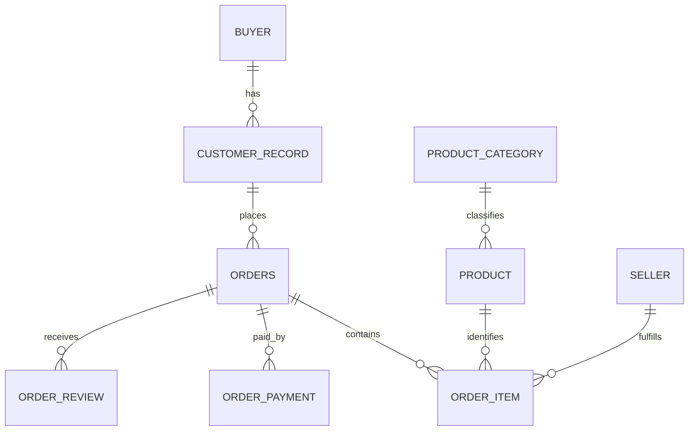

# Модель данных `core`

## Назначение

`core` — типизированная модель для аналитических расчётов из неизменяемой схемы `raw`. Она сохраняет исходную гранулярность фактов и ключи связей, чтобы можно было задавать новые вопросы без переписывания raw-слоя.

## Связи

Факт позиции связан с заказом, товаром и продавцом. Платежи и отзывы хранятся отдельными фактами, поэтому их нельзя без предварительной агрегации напрямую соединять с позициями и суммировать: связи «один ко многим» размножат строки.

## Таблицы и гранулярность

| Таблица | Одна строка | Первичный ключ | Основные связи |
|---|---|---|---|
| `core.buyer` | Постоянный покупатель | `buyer_id` (`customer_unique_id`) | Родитель `customer_record` |
| `core.customer_record` | Адресная/заказная запись покупателя | `customer_id` | FK `buyer_id` → `buyer` |
| `core.orders` | Заказ | `order_id` | FK `customer_id` → `customer_record` |
| `core.order_item` | Позиция одного товара одного продавца в заказе | (`order_id`, `order_item_id`) | FK на `orders`, `product`, `seller` |
| `core.order_payment` | Отдельная часть оплаты заказа | (`order_id`, `payment_sequential`) | FK `order_id` → `orders` |
| `core.order_review` | Одна строка отзыва из источника | `review_row_id` (технический identity) | FK `order_id` → `orders` |
| `core.product` | Карточка товара | `product_id` | FK `category_id` → `product_category` |
| `core.product_category` | Категория источника или sentinel для пустой категории | `category_id` | Родитель `product` |
| `core.seller` | Продавец | `seller_id` | Родитель `order_item` |

### Почему покупатель разделён на две сущности

`raw.customers.customer_id` уникален на запись и используется заказом; один постоянный человек может иметь несколько таких записей. `customer_unique_id` повторяется между ними и представляет устойчивый ключ покупателя. Поэтому `buyer` хранит постоянную идентичность, а `customer_record` сохраняет исходное местоположение и связь заказа. Повторные покупки считаются по `buyer_id`, география конкретного заказа — по `customer_record`.

### Почему ключи фактов составные или технические

- `order_item_id` — порядковый номер внутри заказа, поэтому ключ позиции — (`order_id`, `order_item_id`), а не один `order_item_id`.
- Заказ может иметь несколько способов оплаты; `payment_sequential` нумерует их внутри заказа. Ключ платежа — (`order_id`, `payment_sequential`).
- `review_id` не уникален глобально: в источнике 99 224 строки и 98 410 разных ID. Модель сохраняет каждую строку с `review_row_id`, не дедуплицируя по `review_id`.

## Типы и преобразования

В `raw` все поля остаются текстом. При переносе в `core`:

- даты превращаются в `timestamp` без часового пояса; пустое значение остаётся `NULL`;
- деньги — в `numeric(12,2)`, не в float, чтобы избежать двоичного округления;
- размеры — в `numeric(10,2)`, количества/длины/вес/оценка — в целочисленные типы;
- португальское поле `product_name_lenght` в core переименовано в `name_length`; raw не меняется;
- пустая категория получает ключ `__UNCLASSIFIED__`; две категории без перевода сохраняются под исходными ключами.

Часовой пояс в исходных timestamp явно не указан, поэтому при моделировании он не придумывается. Аномальная последовательность событий остаётся видимой для проверки качества, даты не исправляются автоматически.

## Индексы в `build.sql`

- `orders_purchased_at_idx` поддерживает фильтр по окну дат и группировку по месяцу;
- `orders_customer_id_idx` ускоряет связь заказов с адресной записью клиента;
- индексы `order_item_product_id_idx` и `order_item_seller_id_idx` поддерживают срезы по товару и продавцу;
- `order_review_order_id_idx` поддерживает анализ отзывов на уровне заказа;
- PK-индексы обслуживают соединения по ключам заказа, позиции, платежа и справочников.

## Границы

Выгрузка содержит snapshot текущего статуса заказа и несколько ключевых временных отметок, но не журнал смены статусов. `order_item` не содержит отдельного количества, а сумма платежей не всегда равна сумме позиций с доставкой. Эти свойства нужно отражать в определениях метрик и предупреждениях качества, а не скрывать фильтрами.

## Контракт метрик

## Общие правила

- Для вопросов о продажах, продавцах, среднем чеке и категориях используется окно даты оформления `[2016-09-01, 2018-09-01)`: начало включено, конец исключён.
- Товарная выручка — сумма `core.order_item.item_price` по доставленным заказам. Стоимость доставки `freight_value` в неё не входит.
- Средний чек считается иначе: сначала для каждого доставленного заказа суммируется `item_price + freight_value`, затем берётся среднее по заказам.
- Пустые даты сохраняются как `NULL`. Непустые некорректные даты не исправляются автоматически: приведение типа должно выявить ошибку, а временные аномалии сохраняются и диагностируются.
- В raw нет отдельного количества товаров. Одна строка `order_item` считается одной позицией и одной единицей.

## Определения и контрольные значения

| Метрика | Формула и гранулярность | Фильтр | Источник | Контроль |
|---|---|---|---|---|
| Число заказов по месяцам | `count(order_id)` на месяц оформления; полный календарь из 24 месяцев | Все статусы; дата оформления в окне | `core.orders` | 24 месяца, включая 2016-11 с нулём заказов |
| Товарная выручка по месяцам | `sum(item_price)` на месяц оформления | Только `order_status = 'delivered'`; дата в окне. Фильтр статуса отличается от числа заказов | `core.orders`, `core.order_item` | 13 221 498.11 за период |
| Выручка продавца | `sum(item_price)` его позиций; число заказов — `count(distinct order_id)`, единиц — число строк позиций | Доставленные заказы в окне | `core.order_item`, `core.orders`, `core.seller` | Первый продавец — 226 987.93 |
| Средний чек | Среднее от `sum(item_price + freight_value)` сначала на один заказ | Доставленные заказы в окне | `core.order_item`, `core.orders` | 159.88 |
| Среднее число позиций | Среднее число строк `order_item` на заказ | Те же доставленные заказы в окне, что и средний чек | `core.order_item`, `core.orders` | 1.1422 |
| Среднее число единиц | Среднее число строк `order_item` на заказ, так как отдельного количества нет | Те же доставленные заказы в окне | `core.order_item`, `core.orders` | 1.1422 |
| Покупатели | Число различных постоянных идентификаторов `buyer_id` (`customer_unique_id`) | Все заказы выгрузки; отдельное окно в вопросе не задано | `core.buyer`, `core.customer_record`, `core.orders` | 96 096 |
| Повторные покупатели | Число `buyer_id` с более чем одним заказом; доля = повторные / все покупатели | Все заказы выгрузки | `core.buyer`, `core.customer_record`, `core.orders` | 2 997; 3.12% |
| Выручка по категориям | `sum(item_price)` по категории; доля — категория / общая выручка | Доставленные заказы в окне | `core.order_item`, `core.orders`, `core.product`, `core.product_category` | 74 категории; лидер `health_beauty` — 1 233 131.72; сумма — 13 221 498.11 |

## Правила связей и особых случаев

- `customer_unique_id` (в модели `buyer_id`) — ключ человека между заказами. `customer_id` — адресная/заказная запись; считать покупателей по нему нельзя.
- Платежи — отдельный факт `core.order_payment`. Для сверки с корзиной сначала агрегировать позиции и платежи отдельно до уровня заказа; прямой join размножает суммы.
- Платёжная сумма не заменяет товарную выручку: она включает оплату доставки и может отличаться от суммы корзины.
- Категории с переводом показываются на английском. Две категории без перевода остаются отдельными под исходными именами. Пустая исходная категория отображается отдельной `Unclassified`; товары и продажи не отбрасываются.
- Незаполненные даты остаются `NULL`. Отрицательные интервалы событий не переставляются и не корректируются молча; они остаются видимыми для диагностики.

